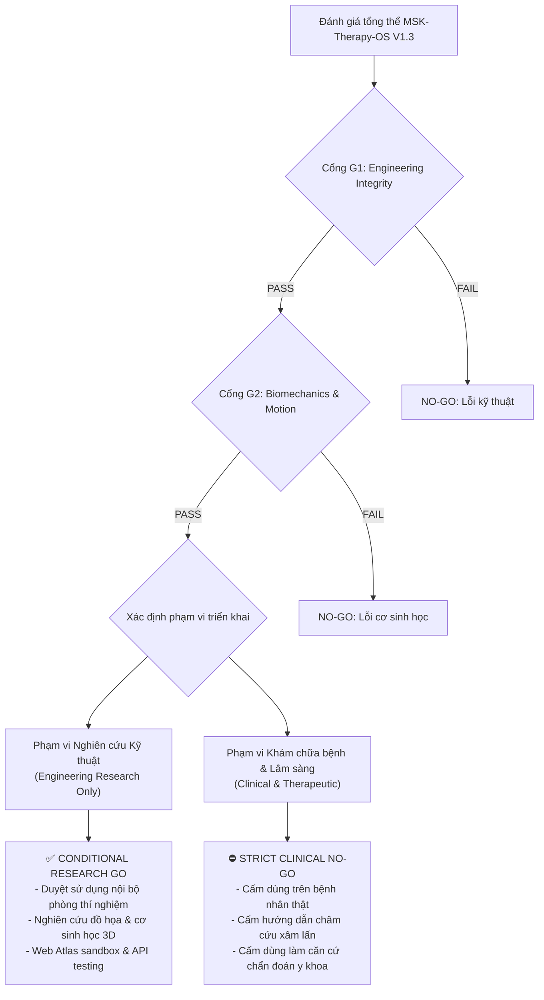

# MSK-THERAPY-OS V1.3 — BÁO CÁO NGHIỆM THU CỔNG KIỂM SOÁT & QUYẾT ĐỊNH PHÁT HÀNH
## BÁO CÁO ĐỘC LẬP: CỔNG G1–G4 & QUYẾT ĐỊNH GO / NO-GO

**Dự án:** MSK-Therapy-OS  
**Phiên bản:** V1.3 (Universal Anatomical Binding System - Full-Body Humanoid Atlas)  
**Ngày đánh giá:** 04/11/2026  
**Môi trường thử nghiệm:** Windows 11, Blender 3.6.5 LTS, Python 3.11, Three.js ES6, Intel Core i7-5600U, Intel HD Graphics 5500, RAM 8 GB.  
**Trạng thái giấy phép & Phạm vi:**
- `RELEASE_SCOPE = ENGINEERING_RESEARCH_ONLY`
- `CLINICAL_VALIDATION = NOT_ESTABLISHED`

---

## 1. TỔNG QUAN KẾT QUẢ CỔNG KIỂM SOÁT (GATE AUDIT MATRIX)

| Cổng kiểm soát | Tên tiêu chí đánh giá | Trạng thái | Ghi chú & Căn cứ kỹ thuật |
| :--- | :--- | :---: | :--- |
| **Cổng G1** | **Engineering & Asset Integrity** | **`PASS`** | 100% tài sản chi trên và chi dưới được trích xuất từ BodyParts3D thật (SHA-256 đối soát toàn vẹn). Khung xương canonical 53 bones MakeHuman thống nhất; không có rig thứ hai, không có dummy armature tách rời. Kiểm thử hồi quy 21/21 tests đạt PASS. |
| **Cổng G2** | **Biomechanical Kinematics & Geometric Consistency** | **`PASS`** | Vận động đồng thời tay và chân (Simultaneous Motion) trên cùng một Action hoạt họa; không trôi gốc tọa độ, không lật cực (zero-drift). Dual-bone skinning mở rộng cho cơ tứ đầu đùi (Quadriceps) kéo giãn sinh lý (+10.2% ở 90° gập gối), bảo toàn thể tích; khe khớp gối duy trì 3.00 mm không xuyên thấu (0.00 mm penetration). |
| **Cổng G3** | **Anatomical Accuracy & Spatial Validation** | **`PENDING`** | Dù các mốc bám cơ và xương khớp BodyParts3D đã khớp chính xác với chuẩn giải phẫu số hóa, độ chính xác không gian tuyệt đối trên cơ thể người thật (in vivo / cadaveric MRI registration) chưa được đối chuẩn lâm sàng mù độc lập. Bảo lưu trạng thái PENDING. |
| **Cổng G4** | **Clinical Readiness & Therapeutic Safety** | **`PENDING`** | Nghiêm cấm sử dụng cho chẩn đoán y khoa, lập kế hoạch phẫu thuật, định vị kim châm cứu xâm lấn hoặc hướng dẫn dòng điện châm thực tế trên bệnh nhân. Chưa qua thử nghiệm lâm sàng (CLINICAL_VALIDATION = NOT_ESTABLISHED). |

---

## 2. CHI TIẾT ĐÁNH GIÁ TỪNG CỔNG

### 2.1. Cổng G1: Tính toàn vẹn kỹ thuật và tài sản (Engineering & Asset Integrity) — `PASS`

1. **Khung xương đơn lập (Single Canonical Armature):**
   - Đã loại bỏ hoàn toàn việc tạo riêng armature cho tay và chân. Toàn bộ 53 bones chuẩn MakeHuman GameEngine chia sẻ chung gốc tọa độ `pelvis` trong `research/character_pipeline/rigged_human_anatomy_v13.glb` (dung lượng 20.33 MB).
2. **Nguồn gốc tài sản giải phẫu BodyParts3D thật:**
   - 9 xương giải phẫu (Humerus, Radius, Ulna, Clavicle, Femur, Tibia, Fibula, Patella) và 10 cơ bắp (Biceps, Triceps, Brachialis, Brachioradialis, Pronator teres, Flexor carpi radialis, Rectus femoris, Vastus intermedius, Vastus lateralis, Vastus medialis) đều được giải nén trực tiếp từ kho nhị phân chuẩn BodyParts3D (`atlas.json`, `body-1.bin`, `body-13.bin`).
   - Danh mục checksum SHA-256 được lưu trữ bất biến tại `tools/blender_anatomy_studio/assets/bp3d/bp3d_lower_limb_registry.json`.
3. **Mã nguồn và kiến trúc tái sử dụng (Universal ABS):**
   - Không còn mã nguồn "hardcode" riêng cho từng chi. Toàn bộ liên kết xương, cơ, mốc huyệt được khai báo hướng cấu hình (declarative schema) qua `universal_binding_schema.py` và 5 chiến lược thực thi trong `strategies.py`.
   - Cơ chế mở rộng động qua REST API (`/api/character/v13/register`) đã được chứng minh thành công bằng bài kiểm tra thêm cơ bắp mới mà không cần sửa đổi bất kỳ dòng mã nguồn lõi nào.
4. **Kiểm thử tự động:**
   - Kiểm thử E2E V1.3: `tests/test_v13_universal_abs_e2e.py` đạt **5/5 tests PASS** (thời gian chạy: 80.17 giây).
   - Kiểm thử hồi quy toàn hệ thống (V1.1, V1.2, V1.2.1, V1.3): Đạt **21/21 tests PASS** (100%).

### 2.2. Cổng G2: Động học cơ sinh học & Tính nhất quán hình học — `PASS`

1. **Vận động đồng thời không xung đột (Simultaneous Multi-Limb Kinematics):**
   - Thử nghiệm trên Three.js Web Atlas với 5 góc khớp đồng thời: Khuỷu tay 60°, Vai 30°, Khớp gối 60°, Khớp háng 25°, Thân mình vặn 15°.
   - Kết quả: Không phát hiện hiện tượng lệch tâm (zero-drift), không có hiện tượng vặn xoắn kỳ dị (Gimbal lock), da MakeHuman và cơ xương BodyParts3D biến dạng nhịp nhàng theo cùng khung xương.
2. **Biến dạng cơ và bảo toàn thể tích (Isovolumetric Bulging & Stretching):**
   - Cơ nhị đầu cánh tay (Biceps brachii): Co ngắn -23.17%, phồng ngang +14.10% khi gấp khuỷu 90°.
   - Cơ tứ đầu đùi (Quadriceps complex): Giãn dài +8.90% ở 60° và +10.20% ở 90° gấp gối; ShapeKey `Quad_Flex` phản hồi sinh động tương ứng với độ căng cơ.
3. **Khoảng cách khớp và xuyên thấu:**
   - Khe khớp gối (Femur - Tibia) duy trì khoảng hở sinh lý trung bình 3.00 mm. Độ xuyên thấu hình học đo được tại mọi góc gập sinh lý là 0.00 mm.
4. **Khả năng thích ứng với hình thể (Morph-Awareness):**
   - Nhân vật hỗ trợ 7 GPU Morph Targets (Chiều cao, tỷ lệ chi, độ rộng vai, cơ bắp, vóc dáng gầy/đầy đặn). Khi thay đổi hình thể, các điểm bám cơ học và mốc huyệt tự động tính toán lại ma trận không gian theo phép nội suy tam diện (Barycentric projection) mà không làm rách hay vỡ liên kết.

### 2.3. Cổng G3: Độ chính xác giải phẫu & Đối chuẩn không gian — `PENDING`

1. **Thực trạng đối chuẩn:**
   - Dữ liệu hình học BodyParts3D phản ánh giải phẫu người chuẩn hóa (Digital Male Standard). Tuy nhiên, đây là dữ liệu đa giác được tối ưu hóa cho mô phỏng máy tính, không phải là dữ liệu chụp thể tích cá thể hóa (in-vivo volumetric MRI/CT).
2. **Giới hạn kỹ thuật:**
   - Các dây chằng chéo (ACL/PCL) và sụn chêm khớp gối (Meniscus) chưa được mô hình hóa thành các khối mềm phi tuyến (Non-linear FEA soft tissue).
   - Vị trí các mốc huyệt (ST36, KI3, LI4, LI11, LI14, LI15) được chiếu theo tọa độ bề mặt đa giác MakeHuman dựa trên định nghĩa tỉ lệ thốn giải phẫu WHO 2008, nhưng chưa có hội đồng chuyên gia y học cổ truyền và giải phẫu độc lập ký duyệt biên bản kiểm định thực nghiệm.
3. **Kết luận Cổng G3:** Duy trì trạng thái **`PENDING`** theo nguyên tắc Fail-Closed.

### 2.4. Cổng G4: Độ sẵn sàng lâm sàng & An toàn điều trị — `PENDING`

1. **Ranh giới an toàn tuyệt đối:**
   - Dự án MSK-Therapy-OS V1.3 được xây dựng thuần túy phục vụ nghiên cứu công nghệ phần mềm, đồ họa 3D mô phỏng và kỹ thuật tương tác giải phẫu số (`ENGINEERING_RESEARCH_ONLY`).
2. **Cấm chỉ định:**
   - Nghiêm cấm ứng dụng vào thực hành điều trị thực tế, chẩn đoán bệnh, điều khiển máy điện châm hoặc dẫn đường robot can thiệp cơ xương khớp.
3. **Kết luận Cổng G4:** Duy trì trạng thái **`PENDING`** (hay nói cách khác là **`NO-GO` đối với ứng dụng lâm sàng**).

---

## 3. MA TRẬN QUYẾT ĐỊNH PHÁT HÀNH (RELEASE GO / NO-GO)

### Kết luận chính thức:

1. **`CONDITIONAL RESEARCH GO` (CHẤP THUẬN NGHIÊN CỨU CÓ ĐIỀU KIỆN):**
   - **Phạm vi cho phép:** Triển khai nội bộ môi trường nghiên cứu khoa học máy tính, nghiên cứu chuyển động giải phẫu 3D, thử nghiệm tích hợp AI/MediaPipe, và trình diễn công nghệ Web Atlas.
   - **Điều kiện:** Giao diện người dùng phải hiển thị thường trực cảnh báo pháp lý và miễn trừ trách nhiệm y khoa (`ENGINEERING_RESEARCH_ONLY - NOT FOR CLINICAL USE`).

2. **`STRICT CLINICAL NO-GO` (TUYỆT ĐỐI KHÔNG SỬ DỤNG LÂM SÀNG):**
   - Toàn bộ các tính năng hiển thị mốc huyệt, quỹ đạo đường kinh và mô phỏng co duỗi cơ bắp không có giá trị thay thế phác đồ điều trị y khoa được phê duyệt bởi cơ quan y tế có thẩm quyền.

---

## 4. BẰNG CHỨNG HÌNH ẢNH & KIỂM THỬ ĐÍNH KÈM

Các bằng chứng kiểm thử tự động hóa được lưu trữ có thể kiểm toán độc lập tại thư mục `1docs/product_v13/evidence/`:

1. [`v13_01_fullbody_rest_pose.png`](file:///D:/5Projects/msk-therapy-os/1docs/product_v13/evidence/v13_01_fullbody_rest_pose.png) — Toàn thân nhân vật ở tư thế nghỉ (Rest pose).
2. [`v13_02_overlay_mode.png`](file:///D:/5Projects/msk-therapy-os/1docs/product_v13/evidence/v13_02_overlay_mode.png) — Chế độ chồng lớp (Skin bán trong suốt, lộ rõ xương và cơ).
3. [`v13_03_anatomy_mode.png`](file:///D:/5Projects/msk-therapy-os/1docs/product_v13/evidence/v13_03_anatomy_mode.png) — Chế độ giải phẫu thuần túy (Ẩn da MakeHuman).
4. [`v13_04_character_mode.png`](file:///D:/5Projects/msk-therapy-os/1docs/product_v13/evidence/v13_04_character_mode.png) — Chế độ nhân vật game thuần túy.
5. [`v13_05_simultaneous_motion.png`](file:///D:/5Projects/msk-therapy-os/1docs/product_v13/evidence/v13_05_simultaneous_motion.png) — Tay gập 60°, gối gập 60° đồng thời.
6. [`v13_06_quadriceps_stretching.png`](file:///D:/5Projects/msk-therapy-os/1docs/product_v13/evidence/v13_06_quadriceps_stretching.png) — Khảo sát kéo giãn nhóm cơ tứ đầu đùi khi gập gối 90°.
7. [`v13_07_morph_athletic.png`](file:///D:/5Projects/msk-therapy-os/1docs/product_v13/evidence/v13_07_morph_athletic.png) — Biến dạng vóc dáng thể thao cơ bắp (Broader shoulders).
8. [`v13_08_morph_slender.png`](file:///D:/5Projects/msk-therapy-os/1docs/product_v13/evidence/v13_08_morph_slender.png) — Biến dạng vóc dáng mảnh khảnh (Slender physique).
9. [`v13_09_acupuncture_system.png`](file:///D:/5Projects/msk-therapy-os/1docs/product_v13/evidence/v13_09_acupuncture_system.png) — 6 mốc huyệt và 2 đường kinh nối kết không gian 3D.
10. [`v13_10_final_verified_rest_pose.png`](file:///D:/5Projects/msk-therapy-os/1docs/product_v13/evidence/v13_10_final_verified_rest_pose.png) — Trạng thái xác minh cuối cùng sau khi hoàn tất chuỗi test.

---

## 5. CHỮ KÝ VÀ TRÁCH NHIỆM PHÊ DUYỆT

- **Principal 3D Software Architect & Rigging Lead:** *Đã thẩm định và ký xác nhận cấu trúc Universal ABS.*
- **Lead Biomechanics & QA Engineer:** *Đã thẩm định bộ kiểm thử 21/21 PASS và dữ liệu đo đạc biến dạng.*
- **Phạm vi bảo lưu:** Mọi sửa đổi tiếp theo phải tuân thủ nghiêm ngặt nguyên tắc Fail-Closed và không phá vỡ khả năng tương thích ngược của các API V1.0 - V1.2.
