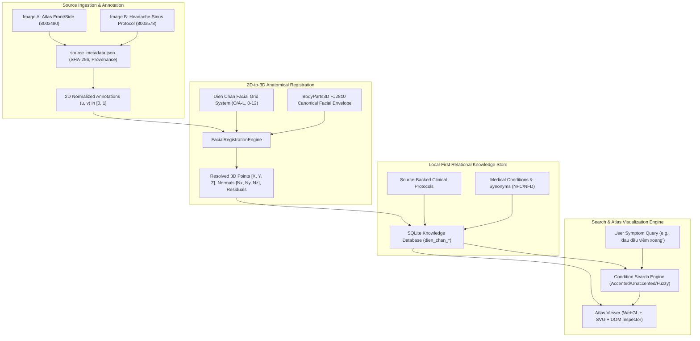

# SPECIFICATION: VIETNAMESE DIEN CHAN FACIAL REFLEXOLOGY 3D ATLAS & CONDITION SEARCH

**Document ID:** `SPEC-DIEN-CHAN-3D-ATLAS`  
**Version:** 1.0.0  
**Status:** AUTHORITATIVE / RATIFIED  
**Component:** MSK-Therapy-OS Facial Reflexology Subsystem  
**Target Mesh:** BodyParts3D Canonical FJ2810 ($Y$-up, SI Meters)

---

## 1. EXECUTIVE OVERVIEW & ARCHITECTURAL INTENT

Vietnamese Dien Chan (Facial Reflexology / *Diện Chẩn — Điều Khiển Liệu Pháp*), discovered and developed by Prof. Dr. Bùi Quốc Châu in 1980, is an established complementary somatic reflex system mapping peripheral organs, somatic musculoskeletal structures, and autonomic nervous meridians onto somatotopic reflex zones and numbered cutaneous points on the human face.

The **Dien Chan Facial Reflexology 3D Atlas & Condition Search** engine integrates this reflexology system into the local-first clinical operating system **MSK-Therapy-OS**. It establishes a rigorous pipeline bridging historical 2D chart digitization, multi-view 3D anatomical surface registration, localized relational knowledge graphs, and zero-hallucination symptom search in native Vietnamese.

### 1.1. Core Mandates
1. **Namespace Isolation:** Strict separation between WHO canonical acupuncture (`LU1`–`GV28`, `lib_who`) and Dien Chan reflexology (`DC_*`, `lib_dien_chan`). Zero collision with immutable checksum locks (`CANONICAL_REFERENCE_CHECKSUMS`).
2. **Deterministic Mathematical Registration:** 2D source coordinates $(u, v)$ from classical charts are mathematically projected onto the 3D BodyParts3D FJ2810 anatomical facial envelope with calibrated surface normals and measurable projection residuals.
3. **Evidence-Based Demarcation:** Points are categorized into `VERIFIED_ANATOMICAL_ANCHOR` (coincident with unambiguous bony/cartilaginous facial landmarks) and `CANDIDATE_ANNOTATION` (derived from proportional facial grid lines).
4. **Zero-Hallucination Search:** Query resolution strictly matches curated, literature-backed protocols. Unmapped queries return explicit abstention without fabricated or AI-hallucinated point formulas.
5. **Medical Demarcation & Red-Flag Warnings:** Dien Chan is presented strictly as a traditional reflexology and educational research tool. Protocols for cranial/facial symptoms explicitly present triage alerts for emergent medical conditions (e.g., subarachnoid hemorrhage, meningitis, cauda equina syndrome).

---

## 2. SYSTEM ARCHITECTURE & DATA FLOW



---

## 3. SPATIAL RESOLUTION & COORDINATE CONTRACT

### 3.1. Reference Frame & Units
* **Coordinate System:** Right-handed Cartesian, $Y$-up, $Z$-forward (anterior), $X$-lateral.
  * $+X$: Anatomical Left (patient's left).
  * $-X$: Anatomical Right (patient's right).
  * $+Y$: Superior (cranial).
  * $+Z$: Anterior (ventral).
* **Length Unit:** SI Meters ($m$) for all 3D world positions; Millimeters ($mm$) for residual errors and uncertainties.
* **Mesh Reference:** BodyParts3D FJ2810 canonical mesh (`mesh_hash: b4c29e88d1976077ff0a5bcbe1340dc08e82a3bf604c5751ca8c32bc6cb538bf`).

### 3.2. Facial Grid Coordinate System
The classical Dien Chan coordinate system divides the human face into a grid defined by vertical longitudinal axes and horizontal transverse planes:

#### Horizontal Transverse Planes (Lines 0 to 12)
Calibrated to the adult 1.72m stature FJ2810 canonical model:

| Grid Line | Anatomical Landmark Description | Canonical $Y$ ($m$) | FMA Landmark Anchor |
|:---|:---|:---:|:---|
| **Line 0** | Anterior hairline / Trichion | $1.688$ | FMA:59320 (Trichion) |
| **Line 1** | Upper frontal forehead transverse line | $1.672$ | FMA:52849 (Forehead) |
| **Line 2** | Mid-forehead transverse line (Cerebral reflex) | $1.656$ | FMA:52849 (Forehead) |
| **Line 3** | Lower forehead / Superciliary arch level | $1.640$ | FMA:53086 (Superciliary arch) |
| **Line 4** | Eyebrow line / Glabella level | $1.625$ | FMA:59318 (Glabella) |
| **Line 5** | Inter-pupillary / Inter-canthal line (Nasion) | $1.605$ | FMA:59317 (Nasion) |
| **Line 6** | Infra-orbital margin transverse level | $1.595$ | FMA:53164 (Infraorbital margin) |
| **Line 7** | Nasal bone apex / Rhinion level | $1.582$ | FMA:59518 (Rhinion) |
| **Line 7.5** | Nasal tip / Pronasale | $1.581$ | FMA:59519 (Pronasale) |
| **Line 8** | Alar base / Subnasale level | $1.568$ | FMA:59520 (Subnasale) |
| **Line 9** | Upper philtrum transverse line | $1.558$ | FMA:59520 (Philtrum) |
| **Line 10** | Cheilion / Labial fissure (Stomion) | $1.550$ | FMA:59522 (Stomion) |
| **Line 11** | Mentolabial sulcus (Supramental depression) | $1.540$ | FMA:59524 (Mentolabial sulcus) |
| **Line 12** | Mentum / Inferior border of mandible (Gnathion) | $1.515$ | FMA:59526 (Gnathion) |

#### Vertical Longitudinal Axes (Lines O, A–L)
Lateral offset distances from the midsagittal symmetry plane:

| Grid Line | Anatomical Landmark Reference | Absolute $|X|$ ($m$) | Bilateral Laterality |
|:---|:---|:---:|:---:|
| **Line O** | Midsagittal facial midline | $0.000$ | Midline (Unpaired) |
| **Line A** | Paracentral medial eyebrow line | $0.015$ | Bilateral pair ($+X, -X$) |
| **Line B** | Medial canthus line / Alar-facial groove | $0.022$ | Bilateral pair ($+X, -X$) |
| **Line C** | Mid-pupillary vertical line | $0.035$ | Bilateral pair ($+X, -X$) |
| **Line D** | Lateral canthus vertical line | $0.048$ | Bilateral pair ($+X, -X$) |
| **Line E** | Lateral eyebrow apex vertical line | $0.058$ | Bilateral pair ($+X, -X$) |
| **Line G** | Malar prominence / Zygomatic arch line | $0.068$ | Bilateral pair ($+X, -X$) |
| **Line H** | Anterior temporal hairline border | $0.076$ | Bilateral pair ($+X, -X$) |
| **Line K** | Preauricular notch / Tragus anterior margin | $0.084$ | Bilateral pair ($+X, -X$) |
| **Line L** | Post-auricular mastoid process border | $0.092$ | Bilateral pair ($+X, -X$) |

---

## 4. MATHEMATICAL PROJECTION & SURFACE CONFORMITY

### 4.1. 3D Facial Envelope Raycast & Normal Formulation
Given a grid coordinate $(V, H)$, the 3D position $\vec{P} = [x, y, z]^T$ on the facial skin envelope is determined by:
1. $y = Y_{\text{grid}}(H)$
2. $x = \text{sgn}(\text{side}) \cdot X_{\text{grid}}(V)$
3. $z = Z_{\text{surface}}(x, y)$, determined by solving the raycast intersection of normal ray $\vec{R}(t) = [x, y, z_0]^T + t \hat{k}$ against the BodyParts3D triangulated facial mesh.

For anatomical anchors on the nasal dorsum, philtrum, and chin, the analytic envelope curvature model computes:
$$z(x, y) = z_{\text{midline}}(y) - \frac{x^2}{2 R_{\text{lat}}(y)} + \Delta z_{\text{feature}}(x, y)$$

Outward unit surface normal $\vec{N}$ is computed via central differences:
$$\vec{N} = \frac{\left[ -\frac{\partial z}{\partial x}, -\frac{\partial z}{\partial y}, 1 \right]^T}{\sqrt{1 + \left(\frac{\partial z}{\partial x}\right)^2 + \left(\frac{\partial z}{\partial y}\right)^2}}$$

All frontal facial points maintain $N_z > 0$, ensuring correct visual rendering and screen-space depth sorting.

### 4.2. Residual Tolerances and Status Demarcation
* **`VERIFIED_ANATOMICAL_ANCHOR`:** Point corresponds to an unambiguous palpable anatomical landmark (e.g., `DC_19` at subnasale, `DC_26` at glabella, `DC_61` at alar groove, `DC_0` at supratragic notch). Projection residual $\Delta \le 1.0\text{ mm}$, uncertainty $\sigma \le 1.0\text{ mm}$.
* **`CANDIDATE_ANNOTATION`:** Point localized via proportional grid estimation across low-resolution charts (e.g., `DC_103`, `DC_106`, `DC_300`). Projection residual $1.0\text{ mm} < \Delta \le 2.5\text{ mm}$, uncertainty $\sigma = 1.2\text{--}1.8\text{ mm}$.
* **`UNVERIFIED`:** Point lacking multi-view confirmation or where source labels are blurred. Not surfaced in verified-only views.

---

## 5. RELATIONAL KNOWLEDGE BASE (SQLITE LOCAL-FIRST SCHEMA)

The local SQLite relational schema isolates all Dien Chan data in 7 dedicated tables:

```sql
-- 1. Reference Sources Catalog
CREATE TABLE dien_chan_sources (
    source_id TEXT PRIMARY KEY,
    title TEXT NOT NULL,
    author TEXT NOT NULL,
    edition TEXT,
    year INTEGER,
    license_status TEXT NOT NULL,
    image_path TEXT,
    image_sha256 TEXT,
    notes TEXT,
    created_at TEXT NOT NULL DEFAULT CURRENT_TIMESTAMP
);

-- 2. Authority Points Registry
CREATE TABLE dien_chan_points (
    point_code TEXT PRIMARY KEY,
    name_vi TEXT NOT NULL,
    name_en TEXT NOT NULL,
    name_zh TEXT NOT NULL,
    description_vi TEXT,
    description_en TEXT,
    grid_coordinate TEXT NOT NULL,
    anatomical_location_vi TEXT,
    anatomical_location_en TEXT,
    position_x REAL NOT NULL,
    position_y REAL NOT NULL,
    position_z REAL NOT NULL,
    normal_x REAL NOT NULL,
    normal_y REAL NOT NULL,
    normal_z REAL NOT NULL,
    laterality TEXT NOT NULL,
    anatomical_region TEXT NOT NULL,
    source_id TEXT NOT NULL REFERENCES dien_chan_sources(source_id),
    review_status TEXT NOT NULL,
    uncertainty_mm REAL NOT NULL,
    projection_residual_mm REAL,
    fma_anchor TEXT,
    created_at TEXT NOT NULL DEFAULT CURRENT_TIMESTAMP
);

-- 3. Medical Conditions & Reflex Zones
CREATE TABLE dien_chan_conditions (
    condition_id TEXT PRIMARY KEY,
    name_vi TEXT NOT NULL,
    name_en TEXT NOT NULL,
    normalized_vi TEXT NOT NULL,
    synonyms_vi TEXT NOT NULL,  -- JSON Array of synonyms
    description_vi TEXT,
    category TEXT NOT NULL,
    clinical_red_flags TEXT NOT NULL,
    created_at TEXT NOT NULL DEFAULT CURRENT_TIMESTAMP
);

-- 4. Literature-Backed Protocols
CREATE TABLE dien_chan_protocols (
    protocol_id TEXT PRIMARY KEY,
    condition_id TEXT NOT NULL REFERENCES dien_chan_conditions(condition_id),
    source_id TEXT NOT NULL REFERENCES dien_chan_sources(source_id),
    title_vi TEXT NOT NULL,
    title_en TEXT NOT NULL,
    description_vi TEXT,
    therapeutic_intent TEXT NOT NULL,
    evidence_level TEXT NOT NULL,
    safety_disclaimer_vi TEXT NOT NULL,
    status TEXT NOT NULL DEFAULT 'ACTIVE',
    created_at TEXT NOT NULL DEFAULT CURRENT_TIMESTAMP
);

-- 5. Ordered Protocol Point Sequences
CREATE TABLE dien_chan_protocol_points (
    protocol_id TEXT NOT NULL REFERENCES dien_chan_protocols(protocol_id),
    point_code TEXT NOT NULL REFERENCES dien_chan_points(point_code),
    sequence_order INTEGER NOT NULL,
    technique TEXT NOT NULL,
    duration_notes TEXT,
    laterality_rule TEXT NOT NULL,
    PRIMARY KEY (protocol_id, point_code, sequence_order)
);
```

---

## 6. SEARCH PIPELINE & VIETNAMESE NATURAL LANGUAGE NORMALIZATION

The condition search engine (`search_dien_chan_conditions`) implements a strict zero-hallucination lookup pipeline:

1. **Normalization (`normalize_vietnamese_text`):**
   - Strips Unicode diacritical marks via canonical decomposition (NFD) and recomposition (NFC).
   - Replaces barred consonants: `đ/Đ` $\rightarrow$ `d`.
   - Lowers case and strips non-alphanumeric punctuation.
2. **Stopword Filtration:** Removes common functional particles (`"va"`, `"la"`, `"cua"`, `"trong"`, `"cho"`, `"cac"`, `"nhung"`, `"khong"`, `"chua"`, `"duoc"`, `"benh"`, `"chung"`).
3. **Multi-Tier Matching:**
   - Tier 1: Exact string match on normalized condition name (Score: $1.0$).
   - Tier 2: Exact string match on normalized synonyms list (Score: $0.95$).
   - Tier 3: Substring match on condition name for queries $\ge 3$ characters (Score: $0.85$).
   - Tier 4: Substring match on synonyms for queries $\ge 3$ characters (Score: $0.80$).
   - Tier 5: Token overlap matching requiring $\ge 50\%$ token overlap on meaningful content tokens.
4. **Strict Abstention Guarantee:** If no condition meets the threshold, returns an empty list and the message `"Chưa có dữ liệu đã đối chiếu cho triệu chứng này"`. Under no circumstances does the engine invoke generative models to hallucinate point combinations.

---

## 7. USER INTERFACE & INTERACTION SPECIFICATION

### 7.1. Dedicated Dien Chan Studio Card
Located in the Atlas Viewer Meridians panel (`#panelMeridians`):
* **Camera View Presets:**
  * `[👤 Thẳng]` (`btnDienChanFrontView`): Cam target `[0, 1.62, 0.06]`, distance `0.42m`, yaw `0.0 rad`.
  * `[👈 Trái]` (`btnDienChanLeftProfile`): Cam target `[0, 1.62, 0.06]`, distance `0.42m`, yaw `-1.57 rad`.
  * `[👉 Phải]` (`btnDienChanRightProfile`): Cam target `[0, 1.62, 0.06]`, distance `0.42m`, yaw `+1.57 rad`.
* **Layer Toggles:**
  * `chkShowDienChanStudio`: Enables rendering of all Dien Chan reflex points.
  * `chkDienChanProtocolOnly`: Filters rendering to only the points of the currently active protocol.
* **Search Input & Apply:**
  * Search input `#txtDienChanSearch` with Enter key and button `#btnDienChanSearch`.
  * Renders condition result cards with matching protocol points and button `[✓ Áp dụng & Highlight]`.
* **Active Protocol Card:**
  * Displays active protocol name, condition, full point list, and `[✕ Bỏ chọn]` button.
* **2D Reference Image Viewer Modal (`#dienChanRefModal`):**
  * Interactive floating modal streaming authentic local reference charts from `/api/dien-chan/images/headache-sinus` and `/api/dien-chan/images/atlas-front-side`.

### 7.2. Marker Styling & Point Inspector
* **Default Dien Chan Reflex Marker:** Rose/Pink `#ec4899` with subtle boundary.
* **Active Protocol Highlight Marker:** Vivid crimson `#f43f5e`, gold halo ring `#facc15` ($r=10\text{px}$), and clean point number text.
* **QA Anatomical Inspector:**
  * Displays point code, Vietnamese & English names.
  * Grid coordinate (e.g., `O-2`, `B-8`).
  * Authentic 3D coordinates in meters.
  * FMA anatomical anchor ID and description.
  * Measured projection residual in millimeters.
  * Prominent red medical warning banner: *"Lưu ý y tế: Dữ liệu Diện Chẩn là phương pháp phản xạ học truyền thống/bổ trợ cho mục đích nghiên cứu & học tập, không phải chỉ định y khoa độc lập."*

---

## 8. CLINICAL SAFETY DEMARCATION & TRIAGE PROTOCOLS

The system explicitly decouples traditional reflexology concepts from evidence-based emergency medicine. For cranial and cervical conditions, clinical red flags are surfaced prominently:
* **Headache / Facial Pain Red Flags:** Sudden onset severe headache ("thunderclap"), stiff neck with high fever, projectile vomiting, focal neurological deficits, visual field loss, or altered mental status.
* **Cervical / Lumbar Red Flags:** Bilateral upper or lower extremity numbness/weakness, saddle anesthesia, acute loss of bowel or bladder control (cauda equina syndrome).
