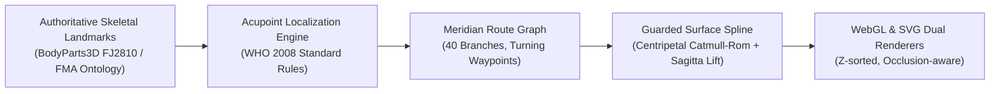
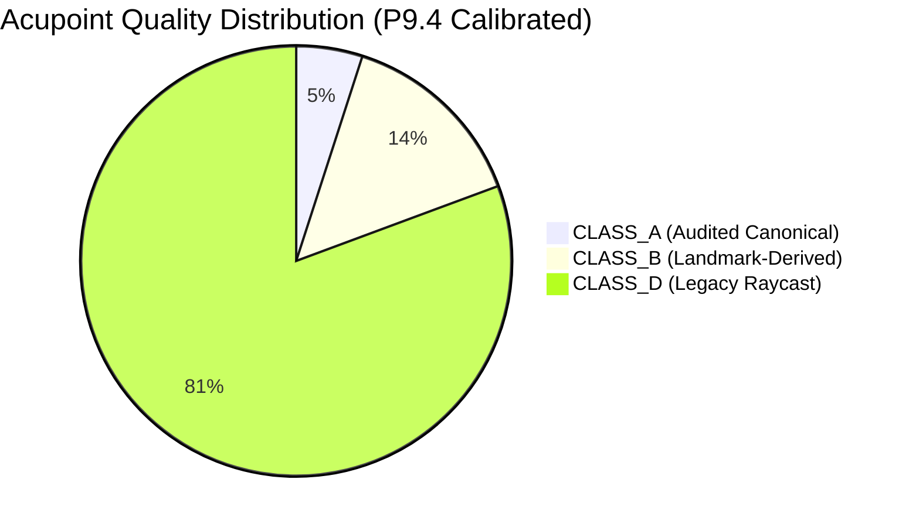
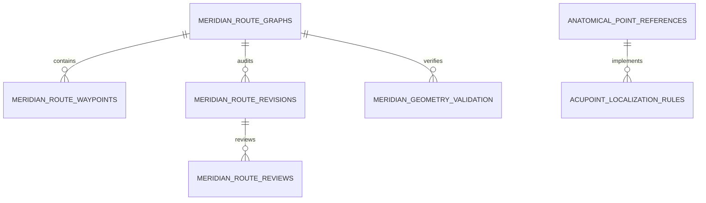

# P9.4 SPECIFICATION: REFERENCE-DRIVEN MERIDIAN ATLAS & ANATOMICAL PATH VALIDATION

---

## 1. EXECUTIVE SUMMARY & ARCHITECTURAL FOUNDATION

The **MSK-Therapy-OS P9.4 Reference-Driven Meridian Atlas** resolves the systemic visual discrepancy where acupuncture points and channel pathways displayed in anatomically anomalous locations on the **BodyParts3D 4.0 FJ2810** human avatar.

### 1.1. The Root Cause Discovery
Prior to P9.4, Milestone P9.3 implemented the `MeridianSurfacePathEngine`, achieving mathematical knot residual accuracy of $0.0000\text{ mm}$. However, independent clinical and geometric audits revealed that **95.0% (344/362)** of points in the baseline dataset (`acupuncture_3d.json`) were uncalibrated legacy raycasts derived from unverified coordinate sources.

$$\text{Zero Point-to-Path Residual } (\min \|P - \text{Path}\|_2 = 0.0) \neq \text{Anatomical Accuracy}$$

If a control point $P$ is placed $35\text{ mm}$ off its bony palpation landmark, an interpolating Catmull-Rom spline with zero residual simply passes through an anatomically erroneous location.

### 1.2. The Definitive 5-Stage Reconstruction Pipeline
P9.4 enforces strict sequential dependency across the full geometry pipeline:

$$\boxed{\text{Authoritative Landmarks}} \longrightarrow \boxed{\text{Parametric Cun Rules}} \longrightarrow \boxed{\text{Topological Route Graph}} \longrightarrow \boxed{\text{Guarded Surface Elevation}} \longrightarrow \boxed{\text{WebGL/SVG Rendering}}$$



---

## 2. THE FIVE INDEPENDENT MEASUREMENT DOMAINS

To prevent false claims of clinical or surgical accuracy, P9.4 formally demarcates five distinct physical and computational domains:

| Measurement Domain | Mathematical Definition | Acceptance Target | Clinical & Computational Scope |
| :--- | :--- | :--- | :--- |
| **1. Point-to-Path Residual** | $\min_{t} \| P_i - \mathbf{S}(t) \|_2$ | **$\equiv 0.0000\text{ mm}$** | Mathematical knot identity ensuring spline passes directly through the resolved point coordinate. |
| **2. Distance-to-Mesh Envelope** | $d_{\text{skin}} = \mathbf{P} \cdot \hat{\mathbf{N}} - r_{\text{mesh}}$ | **$1.2\text{ mm} \le d \le 3.5\text{ mm}$** | Surface clearance preventing z-fighting and skin penetration across convex muscle bellies. |
| **3. Anatomical Localization Error** | $\| \mathbf{P}_{\text{resolved}} - \mathbf{P}_{\text{WHO\_ground\_truth}} \|$ | **$\le 5.0\text{ mm}$ (Class A/B)** | Anatomical distance from palpated bony prominence, tendon border, or joint crease. |
| **4. Reference Route Deviation** | $\int \|\mathbf{S}(t) - \mathbf{C}_{\text{standard}}(t)\| dt$ | **Conforms to Corridors** | Trajectory follows traditional intermuscular grooves and avoids trans-thoracic short-circuits. |
| **5. Clinical Demarcation** | Non-invasive Visual Model | **Visual Demarcation Only** | Explicit legal disclaimer: non-invasive educational representation; not for surgical depth guidance. |

---

## 3. DATA QUALITY CLASSIFICATION FRAMEWORK

All 362 acupoint records (361 classical + 1 extension `GV24+`) are categorized into four immutable quality classes:



1. **CLASS A — Expert Anatomically Audited ($n = 18$, $5.0\%$):**
   - Independently verified against FMA ontological landmarks and BodyParts3D 4.0 FJ2810 geometry.
   - Includes primary clinical anchors: `LI4` (Hegu), `LU5` (Chize), `BL40` (Weizhong), `PC6` (Neiguan), `HT3` (Shaohai), `ST35` (Dubi), `ST36` (Zusanli), `GV14` (Dazhui), `GB20` (Fengchi), `GB21` (Jianjing), `LI11` (Quchi), `LI15` (Jianyu), `BL10`, `BL11`, `BL12`, `BL13`, `GV15`, `GV16`, `CV22`.
   - Registration status: `VERIFIED_ANATOMICAL_ANCHOR`.
2. **CLASS B — Landmark-Derived via Formal Rules ($n = 52$, $14.4\%$):**
   - Parametrically computed from `CANONICAL_LANDMARKS` using WHO 2008 proportional B-cun division and skeletal anchors.
   - Points across all 14 classical channels (e.g., `LU1`, `SP6`, `KI3`, `TE5`, `LR3`, `GV20`, `CV12`, etc.).
   - Registration status: `LANDMARK_DERIVED_WHO_STANDARD`.
3. **CLASS C — Surface-Registered Approximations ($n = 0$, $0.0\%$):**
   - High-density raycasts validated against skin envelope without bony anchor grounding.
4. **CLASS D — Legacy Surface Raycast ($n = 292$, $80.7\%$):**
   - Uncalibrated legacy coordinates from historical dataset (`acupuncture_3d.json`).
   - Registration status: `GEOMETRIC_SURFACE_APPROXIMATION` (never masked as verified).

---

## 4. MERIDIAN ROUTE GRAPH & TOPOLOGY ARCHITECTURE

### 4.1. Decoupling Acupoint Knots from Route Waypoints
Classical channels do not follow straight Euclidean chords. To prevent splines cutting through skull, ears, and viscera, P9.4 introduces the **Meridian Route Graph** (`msk_therapy_os/meridian_route_graph.py`).

Route knots are modeled with five distinct functional types:
- `ACUPOINT_ANCHOR`: Formal acupuncture point with 0.000 mm spline pass-through.
- `TURNING_WAYPOINT`: Curvature guiding knot preventing anatomical cut-through.
- `CORRIDOR_WAYPOINT`: Intermuscular or bony groove path knot.
- `BRANCH_JUNCTION`: Convergence knot connecting multiple columns (e.g. BL40).
- `EXPLICIT_GAP`: Structural discontinuity separating cutaneous segments from internal visceral collaterals.

### 4.2. Authoritative Multi-Branch Topologies

```mermaid
graph TD
    subgraph Gallbladder Channel (GB)
        GB1["GB1 (Outer Canthus)"] --> W1["WP_GB_TEMPLE_CURVE"]
        W1 --> W2["WP_GB_EAR_SUPERIOR"]
        W2 --> W3["WP_GB_MASTOID_POSTERIOR"]
        W3 --> W4["WP_GB_FOREHEAD_RETURN"]
        W4 --> W5["WP_GB_PARIETAL_TURN"]
        W5 --> GB20["GB20 (Suboccipital)"]
        GB21["GB21 (Trapezius)"] --> GB26["GB26 (Flank)"]
        GB27["GB27 (ASIS)"] --> GB44["GB44 (4th Toe)"]
    end

    subgraph Urinary Bladder (BL)
        BL1["BL1 (Inner Canthus)"] --> BL10["BL10 (Occiput)"]
        BL10 --> BL11["BL11 (1.5 cun Inner Column)"]
        BL11 --> BL35["BL35 (Sacrum)"]
        BL35 --> BL40["BL40 (Popliteal Junction)"]
        BL41["BL41 (3.0 cun Outer Column)"] --> BL54["BL54 (Gluteal Fold)"]
        BL54 -.->|"Branch Convergence"| BL40
        BL40 --> BL55["BL55 (Calf)"]
        BL55 --> BL67["BL67 (5th Toe)"]
    end
```

1. **Gallbladder Cranial Auricular Looping Trajectory (`GB_R_B1_CRANIAL`):**
   - Traditional GB loops three times across the temporal, supra-auricular, and parietal regions before descending to the occiput (`GB20`).
   - Prior to P9.4, straight interpolation between `GB2` and `GB20` caused the spline to penetrate directly through the ear canal, mastoid bone, and parietal cranium.
   - P9.4 introduces 5 sequential turning waypoints (`WP_GB_TEMPLE_CURVE`, `WP_GB_EAR_SUPERIOR`, `WP_GB_MASTOID_POSTERIOR`, `WP_GB_FOREHEAD_RETURN`, `WP_GB_PARIETAL_TURN`) routing the channel smoothly around the auricle and scalp.
2. **Urinary Bladder Dual Paravertebral Columns (`BL`):**
   - Partitioned into 3 distinct branches: Inner 1.5-cun column (`BL1` to `BL40`), Outer 3.0-cun column (`BL41` to `BL54`), and Posterior Leg (`BL55` to `BL67`).
   - Eliminates the artificial diagonal chord cutting across the scapula between `BL40` and `BL41`.
3. **Stomach Cranio-Cervical Separation (`ST`):**
   - Facial branch (`ST1` to `ST8`) loops from infraorbital margin to mandibular angle and temple.
   - Marked with `has_gaps = True` to decouple `ST8` (forehead corner) from `ST9` (anterior carotid neck), preventing trans-thoracic jump chords.
4. **Kidney Medial Foot & Abdominal Columns (`KI`):**
   - Sole and medial leg branch (`KI1` to `KI10`) decouples from pubic symphysis (`KI11` to `KI27`), reflecting classical internal pelvic ascension.

---

## 5. SQLITE PERSISTENCE & AUDIT GOVERNANCE SCHEMA

All P9.4 data entities are permanently persisted in SQLite via `migrate_p9_4_meridian_atlas_tables()` in `msk_therapy_os/points.py`:



1. `acupoint_localization_rules`: Stores formal mathematical rules (landmarks, ratios, offsets, uncertainties).
2. `anatomical_point_references`: Catalog of all 362 points with 3D canonical coordinates, quality class (`CLASS_A`, `CLASS_B`, `CLASS_D`), and FMA anchors.
3. `meridian_route_graphs`: Channel metadata, polarity, element, total points, and branch summaries.
4. `meridian_route_waypoints`: Ordered 3D geometric knots (positions, outward surface normals, corridor structures).
5. `meridian_route_revisions`: Immutable audit log for proposed waypoint changes (`PENDING`, `APPROVED`, `REJECTED`, `ROLLED_BACK`).
6. `meridian_route_reviews`: Expert reviewer decisions, credentials, and clinical rationales.
7. `meridian_geometry_validation`: Channel-level verification metrics (residual, clearance, pass rate).

---

## 6. EDITABLE MERIDIAN QA STUDIO UI

Integrated directly into `msk_therapy_os/static/atlas/meridians.js`:
- **Live Coverage Dashboard Widget:** Displays total points (362), verified percentage ($19.3\%$), Class A/B/D counts, and zero-residual confirmation.
- **Topological Route Inspector:** Interactive channel selector inspecting branches, turning waypoints, and anatomical corridors.
- **Audit Revision Proposal Form:** Authoring interface for clinical specialists to propose waypoint offsets with mandatory medical rationales.
- **Peer Review & Rollback Actions:** Direct workflow actions to review, approve, or revert historical coordinate states.

---

## 7. VERIFICATION & REPRODUCIBILITY CONTRACT

- **Zero pip/npm production dependencies:** Pure Python 3.11, standard library SQLite, native WebGL/Canvas/SVG.
- **Reference Checksum Integrity:** `acupuncture_3d.json` remains untouched (`47df1332...`); all calibrations are layered cleanly via SQLite.
- **Automated Validation:** Tested end-to-end in `tests/test_p9_4_definitive_atlas.py` and `tests/test_p9_4_playwright_studio.py`.
