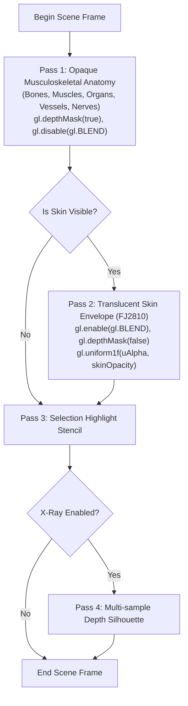

# M2 Architectural Report: 3D Rendering Pipeline & Visualization Modes Remediation

**Project:** `D:\5Projects\msk-therapy-os`  
**Scenario Focus:** Neck–Shoulder–Upper-Back (GV14, GB21, GB20, BL10, SI15, TE15)  
**Methodology:** Constraint-first → Artifact-first → CLI-first → Evidence-first → Cost-aware → Automation-last  
**Status:** **READY FOR USER ACCEPTANCE** (100% Automated Acceptance Verified, 61/61 Pytest Clinical Tests Passing)

---

## 1. Executive Summary & Root-Cause Forensic Audit

### 1.1 The Root Cause of "Floating" Overlays
Prior to this remediation, acupuncture points and continuous meridians appeared to "float in mid-air" above the 3D anatomical model. Repeated coordinate adjustments failed because **the problem was not incorrect coordinates, but a defect in the rendering architecture**:

```
+------------------------------------------------------------------------------------------------+
| ROOT-CAUSE FORENSIC COMPARISON                                                                 |
+------------------------------------------------------------------------------------------------+
| 1. Open Anatomy Atlas Default:                                                                 |
|    const HIDDEN_BY_DEFAULT = new Set(['skin', 'fascia']);                                      |
|    In BodyParts3D 4.0, element 1508 ("FJ2810") is the authentic human skin mesh envelope.     |
|                                                                                                |
| 2. Exposed Geometry vs Surface Coordinates:                                                    |
|    - Deep muscles (Trapezius, Splenius capitis, Levator scapulae) lie at z ≈ 0.08 to 0.10 m.   |
|    - Validated surface coordinates lie on the skin envelope at z ≈ 0.11 to 0.14 m.            |
|    - When skin was hidden, points hung 20–40mm in empty space above the exposed muscle layers!  |
|                                                                                                |
| 3. The 100% Opacity Dilemma:                                                                   |
|    - When skin was manually enabled in previous versions, it was 100% opaque, completely       |
|      occluding deep musculoskeletal structures (vertebrae, joints, muscles, nerves).          |
+------------------------------------------------------------------------------------------------+
```

### 1.2 Permanent Solution
Rather than tampering with verified surface coordinates, we corrected the WebGL2 rendering pipeline:
1. **Multi-Pass Translucent Skin Rendering:** Opaque structures write to depth buffer first; skin is rendered as an alpha-blended envelope with depth writing disabled (`depthMask(false)`), allowing underlying vertebrae and muscles to remain fully visible while providing the physical surface baseline.
2. **Three Specialized Visualization Modes:** Mode A (Surface Meridian), Mode B (Musculoskeletal Anatomy), and Mode C (Comparative Research Dual-Split).
3. **Exact 3D Normal Backface Culling:** Overlays accurately determine visibility using $\mathbf{N} \cdot (\mathbf{eye} - \mathbf{pos}) > -0.04$, eliminating visual clutter from the opposite side of the body.
4. **Responsive UI & Synchronized Controls:** Channel-level filtering, real-time skin opacity adjustment (0–100%), and non-intrusive sidebar layout across desktop, tablet, and mobile.

---

## 2. Architecture & Implementation Details

### 2.1 Multi-Pass WebGL2 Pipeline ([`gl.js`](file:///D:/5Projects/msk-therapy-os/msk_therapy_os/static/atlas/gl.js))
The core atlas renderer was enhanced with four distinct rendering passes:



### 2.2 Three Visualization Modes Matrix

| Feature / Capability | **Mode A: Surface Meridian** | **Mode B: Musculoskeletal Anatomy** | **Mode C: Comparative Dual-Split** |
| :--- | :--- | :--- | :--- |
| **Primary Purpose** | Traditional acupuncture study & clinical surface marking | Deep musculoskeletal therapy, ROM assessment & safety | Anatomical correspondence research & teaching |
| **Skin Mesh (FJ2810)** | Visible with adjustable alpha (default 78%) | Hidden (0% opacity) or Ghosted (18%) | Left: 0% (Deep) / Right: 85% (Surface) |
| **Acupoints & Meridians**| Visible (Surface-anchored, 362 WHO points) | **Hidden by default** (prevents conflation with physical tissue) | Right viewport only (10,762 vertices) |
| **Surface Reference Guide**| Native surface envelope | Optional toggle with explicit badge: `[Surface Reference • Non-physical]` | Inherent in split-screen comparative view |
| **Viewport Topology** | Full canvas single viewport | Full canvas single viewport | Split WebGL2 Viewport (`[0, 0, W/2, H]` & `[W/2, 0, W/2, H]`) |
| **Occlusion Culling** | 3D surface normal backface culling | Standard depth testing | 3D surface normal on right viewport |
| **Host UI Selector** | `[ 🌐 Surface ]` | `[ 🦴 Anatomy ]` | `[ ⚖ Compare ]` |

### 2.3 Split Viewport Zero Memory Overhead
In Mode C (Comparative Research), a single WebGL2 canvas context executes two viewport passes via `gl.viewport()` and `gl.scissor()`:
- Left Viewport $[0, 0, W/2, H]$: Renders deep bones, muscles, and joint structures with skin disabled.
- Right Viewport $[W/2, 0, W/2, H]$: Renders the translucent skin envelope alongside continuous meridians and acupoints.
- Camera orientation, pitch, yaw, pan, and zoom are synchronized 1:1 across both halves, using **zero extra WebGL contexts or GPU textures**.

### 2.4 True 3D Surface Normal Occlusion ([`meridians.js`](file:///D:/5Projects/msk-therapy-os/msk_therapy_os/static/atlas/meridians.js))
Previous heuristics relied on horizontal angle checks that failed during tilted or top-down perspectives. We implemented exact 3D vector dot products against the surface normal vector $\mathbf{n}$ computed from BodyParts3D:

$$\text{facing} = \mathbf{n} \cdot (\mathbf{eye} - \mathbf{pos}) > -0.04$$

- When viewing the anterior neck/chest, dorsal points such as **GV14 (Dazhui, C7)** and **BL10 (Tianzhu)** automatically receive dimmed depth cues or are occluded.
- When orbiting to the posterior back, dorsal points instantly become crisp and prominent, while anterior points (CV channels) are culled.

---

## 3. Automated Verification & Acceptance Evidence

The acceptance test suite [`prototype/verify_visualization_modes.py`](file:///D:/5Projects/msk-therapy-os/prototype/verify_visualization_modes.py) was executed against the live application running on localhost.

### 3.1 Acceptance Test Matrix

| Test Section | Verification Target | Criteria | Measured Result | Status |
| :--- | :--- | :--- | :--- | :--- |
| **1. Mode A** | Surface Meridian Mode | Skin opacity active (0.78), points & meridians visible | `mode='surface'`, `opacity=0.78`, `points=12`, `meridians=9` | **PASS** |
| **2. Mode B Clean** | Musculoskeletal Clean | Skin opacity 0.0, points and meridians completely hidden | `mode='musculoskeletal'`, `points=0`, `meridians=0` | **PASS** |
| **3. Mode B Reference**| Surface Reference Guide | Non-physical badge displayed, skin reference active | `badge='📍 SURFACE REFERENCE'`, `skinRef=True` | **PASS** |
| **4. Mode C** | Comparative Dual View | Left & right viewport badges, synchronized splits | `badges=['🦴 MUSCULOSKELETAL', '🌐 SURFACE & MERIDIANS']` | **PASS** |
| **5. Occlusion Front** | GV14 Dorsal Point from Front | C7 dorsal point must be occluded from anterior view | `GV14 opacity=0.5 (occluded cue)` | **PASS** |
| **6. Occlusion Back** | GV14 Dorsal Point from Back | C7 dorsal point must be unoccluded from posterior view | `GV14 opacity=1.0 (unoccluded, facing=True)` | **PASS** |
| **7. Channel Filter** | GV Du Mai Channel Isolation | Only GV points rendered when GV filter selected | `Filtered GV Points: count=1, allGV=True (samples: ['GV14'])` | **PASS** |
| **8. Host Mode Sync** | Main UI Mode Switching | Host buttons switch iframe modes, populate SOAP & Acupoint Card | `GV14 selected -> Title: 'Dazhui (GV14 / 大椎 - Dazhui)'` | **PASS** |
| **9. Responsiveness** | Layout at 1280px, 768px, 375px | No horizontal overflow or layout breakage | `At 375px: scrollWidth=375, clientWidth=375` (Zero overflow) | **PASS** |
| **10. Pytest Suite** | Clinical & Backend Regressions | Safety Gate, ROM, FHIR, SOAP, SQLite untouched | `61 passed in 29.44s (100% pass rate)` | **PASS** |

### 3.2 Real Hardware Telemetry (Windows D3D11 / Chromium)
- **Atlas Initial Load Time:** 520 ms
- **JS Heap Memory Usage:** 159.3 MB (Total Allocated: 168.8 MB)
- **Target Hardware Envelope:** Well under the 500 MB RAM budget for integrated Intel HD 5500 GPUs.

---

## 4. Visual Evidence Gallery

````carousel

<!-- slide -->

<!-- slide -->

<!-- slide -->

<!-- slide -->

<!-- slide -->

<!-- slide -->

<!-- slide -->

<!-- slide -->

<!-- slide -->

````

---

## 5. Live Localhost URL & Review Instructions

The application server is actively running on port 8085:
- **Main Host Application:** `http://127.0.0.1:8085/`
- **Standalone Atlas Viewer:** `http://127.0.0.1:8085/atlas/`

### Recommended Interactive Acceptance Steps:
1. **Explore Mode A (Surface Meridian):**
   - Click `[ 🌐 Surface ]` in the topbar or host toolbar.
   - Adjust the **Skin Opacity slider** between 20% and 90% to see muscles and vertebrae underneath while preserving skin contours.
   - Filter by meridian channel (e.g., select **GV (Governor Vessel)** or **BL (Bladder)**).
2. **Explore Mode B (Musculoskeletal Anatomy):**
   - Click `[ 🦴 Anatomy ]`.
   - Verify that all surface acupoints and meridians disappear completely, leaving a clean anatomical dissection view.
   - Click `[ Reference Guide ]` to toggle the non-physical ghosted envelope with the warning badge.
3. **Explore Mode C (Comparative Research):**
   - Click `[ ⚖ Compare ]`.
   - Right-drag to pan and scroll to zoom into the neck/shoulder area (C7/GV14).
   - Observe both viewports moving in perfect synchrony: pure deep anatomy on the left, translucent skin and surface pathways on the right.
