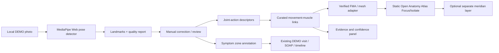

# MSK-Therapy-OS — M2.5 Pose-to-Anatomy Explorer

**Engineering specification / coding-agent handoff**  
**Version:** 1.0 · **Prepared:** 2026-10-22  
**Repository:** `D:\5Projects\msk-therapy-os`  
**Status:** Proposed milestone; **not yet implemented or validated**  
**Primary audience:** Staff/Principal Engineer, computer-vision developer, 3D visualization developer, qualified clinical reviewer

> **Mission:** From an uploaded exercise/posture photograph or short movement video, let a learner explore the observed body pose, examine *potentially involved* anatomical structures in the existing Open Anatomy Atlas, document where a fictional patient reports symptoms during that pose, and compare observations over time. **Do not convert a photograph into a diagnosis or measured muscle-activation map.**

## 0. Operating principles

Follow **Constraint-first → Artifact-first → CLI-first → Evidence-first → Cost-aware → Automation-last**.

1. **Reuse before building.** Inspect the working M2/M2.1/M2.2 code and open-source components before writing new code. Preserve Atlas, meridians, SOAP, SQLite, safety, timeline and FHIR export.
2. **Ship a truthful MVP.** A still image supports body-landmark detection and uncertain pose interpretation, **not** reliable measurement of muscle activation, muscle force, internal tissue pathology or a cause of pain. Do not label a muscle “activated” unless evidence supports that exact claim.
3. **Two model spaces are not one model.** A pose skeleton inferred from a photo is separate from the **non-articulated, reference anatomical meshes** in Open Anatomy Atlas. Never warp its internal muscles/nerves/vessels or acupuncture coordinates using generic human-body pose transforms.
4. **Evidence is a data type.** UI and exports must identify whether information is directly observed, model-estimated, curated anatomical/biomechanical teaching content, traditional-theory metadata, or practitioner-reported.
5. **Synthetic-only initially.** No production patient photo, personal identifier, consultation or health record until security, consent, professional supervision and applicable legal obligations are separately fulfilled.

---

## 1. Problem / target user

**Current gap:** MSK-Therapy-OS shows static adult-male anatomical reference geometry with acupoints/meridian overlays and tracks anatomical observations. Learners cannot upload a pose photo, identify what positions the joints appear to occupy, investigate *possibly involved* muscles/joints for that task, or associate position-specific symptom reports with a DEMO case and follow-up timeline.

**Primary stories**

- **Educational exercise analysis:** Learner uploads a licensed sample image of a Pilates V-up/boat-like abdominal hold. Application detects key landmarks, draws the skeletal pose, summarizes probable joint actions and allows the learner to explore candidate muscles with a source-backed role explanation (agonist / stabilizer / antagonist, where supportable).
- **Symptom-guided learning:** In a synthetic scenario, learner uploads a pose showing shoulder elevation and documents “pain reported in left lateral neck during movement.” Application displays related regions, verified anatomical structures and red-flag questions; it **does not** infer that levator scapulae is injured or a nerve is compressed.
- **Longitudinal documentation:** A simulated case has the same movement repeated on different days. The user records pain score, measured ROM if available, functional context, side, activity and clinician-reviewed notes; the timeline reveals changes without falsely equating camera angles or inferred angles with clinical goniometry.

**Out of scope for MVP**

- No diagnosis of sciatica, cervical radiculopathy, tendon damage, ischemia, nerve compression or “meridian blockage” from a pose.
- No patient-specific deep anatomical reconstruction, contact/penetration safety depth, EMS/DDS dosage or chiropractic manipulation guidance.
- No automatic estimates of EMG, individual muscle forces, joint loading, muscle recovery, acupuncture effectiveness or exact muscle activation from a single photograph.
- No proprietary book exercise images incorporated into the shipped repository without rights.
- No heavy video simulation or GPU-required local inference in the MVP.

---

## 2. Constraint-first feasibility

| Concern | Hard constraint / design decision |
|---|---|
| Hardware | Windows x64, i7-5600U, 8 GB RAM, Intel HD 5500; app remains local-first and CPU-friendly. Avoid requiring CUDA, PyTorch or large GPU runtimes for MVP. |
| Existing architecture | Respect actual repository boundaries. Prior handoff reports Python stdlib HTTP server, SQLite, static WebGL anatomy viewer and separate 3D meridian overlay. **Verify against checkout, do not assume reports equal live code.** |
| Pose extraction | Prefer **MediaPipe Pose Landmarker for Web** (image mode first), using an audited/pinned `@mediapipe/tasks-vision` package and model. Verify browser compatibility, CPU fallback and license of bundled model separately. |
| More advanced capture | **OpenCap Core** requires multiple videos and generally CUDA-grade compute for local pipeline. **OpenCap Monocular** is single-*video*, not single-image muscle-force inference; its current installation calls for NVIDIA and it has noncommercial licensing. Treat as optional research adapter, not required dependency. |
| Skeletal/force modeling | **OpenSim** provides biomechanical models and computation but requires appropriate motion data, model calibration and assumptions; results cannot be presented as directly measured from photo. |
| 3D body model | SMPLify-X can fit a human shape/pose to an image, but has noncommercial research restrictions and substantive dependencies. **DEFER** unless use case, license, hardware and reproducibility are explicitly cleared. |
| Privacy | Local DEMO assets only, served from `127.0.0.1`; disable remote upload/telemetry by default. Uploaded patient photos could be identifying even without a name. |
| Medical safety | Existing Safety Gate takes precedence; prompts for urgent symptoms and device contraindications stay available. Nothing in pose analysis bypasses or overrides STOP_AND_REFER. |
| Traditional content | Meridian and acupoint overlays remain *separate reference or traditional-theory layers*, never biomechanical output nor a reconstructed patient-specific coordinate system. |

### External components: inspect before adopting

| Source | URL | Decision for M2.5 |
|---|---|---|
| MediaPipe Pose Landmarker (Web) | https://developers.google.com/edge/mediapipe/solutions/vision/pose_landmarker/web_js | **EVALUATE / ADAPT** as MVP pose landmark detector. Main MediaPipe repository: https://github.com/google-ai-edge/mediapipe; Apache-2.0 code, independently audit runtime/model assets. |
| Open Anatomy Atlas | https://github.com/CognitionLabSNUC/open-anatomy-atlas | **REUSE** existing local renderer, focus/isolate, structures and identifiers. Unposed reference anatomical geometry. |
| OpenCap Core | https://github.com/opencap-org/opencap-core | **DEFER** optional multi-camera video research pipeline; document local GPU and calibration requirements. |
| OpenCap Monocular | https://github.com/utahmobl/opencap-monocular | **DEFER** GPU-intensive single-video pipeline; **PolyForm Noncommercial** project license, dependent model licenses. |
| OpenSim Core | https://github.com/opensim-org/opensim-core | **DEFER** optional validated motion/biomechanics processing. Apache-2.0 core, check model/data asset licenses. |
| SMPLify-X | https://github.com/vchoutas/smplify-x | **REJECT for production MVP / evaluate only** due to noncommercial research license and dependencies. |

**Licensing deliverable:** `docs/M2_5_OSS_LICENSE_MATRIX.md` with exact upstream commit/tag, license for **code and model weights and training artifacts**, attribution obligations, and commercial eligibility. Never copy noncommercial dependencies into a potentially commercial app by default.

---

## 3. User experience: one coherent workspace

**Primary entry point:** `Pose Explorer` tab beside Anatomy / Meridian / Clinical observations, searchable through Unified Anatomy Search when available.

### Layout

1. **Import panel (left):** upload synthetic/public-domain photo (MVP), choose `IMAGE`; allow camera/view orientation selection (front / side / back / uncertain), optional mirror correction, manually mark side and posture name. Show privacy warning and supported content formats. File metadata: size, dimensions, SHA-256, source/license, created date, synthetic-demo status.
2. **Pose analysis pane (center-left):** display image with detected keypoints and skeleton; confidence/readability per joint; allow correction of key landmark locations and left-right orientation. Show `Estimated from single image` conspicuously. No pseudo-3D “ground truth” effect.
3. **Anatomy pane (center-right):** show existing real Atlas. Selecting joint action/body region highlights candidate structures **on the static reference anatomy**; rotation, focus, isolate, muscle layer visibility still work. For clearer spatial comparison, optional simplified 2D/3D pose skeleton appears **beside** Atlas, not welded to internal anatomical meshes.
4. **Insights panel (right or below):** joint actions (observed/estimated), possible muscle roles (curated + cited), joints/surface landmarks, associated nerves, and traditional acupoint overlay in **separate, user-toggled sections**. Show a clear `Why this muscle?` explanation and confidence/evidence provenance.
5. **Clinical learning panel:** select DEMO case → choose reported pain zone and side → note onset, phase of movement, severity, symptoms and functional limitations → save structure-linked observation and/or SOAP draft. Existing safety checklist remains accessible.
6. **Timeline:** compare repeated activities on Day 1 / 3 / 7 with independently entered pain, ROM measurements, observations and thumbnails. Clearly label **measurement method and comparability** (camera/motion conditions matter).

### Visual vocabulary (semantic, not theatrical)

- **Blue:** selected anatomical *reference structure* (where it exists in data).
- **Amber:** *potentially involved* muscle based on curated activity-to-muscle role mapping, **not measured activation**.
- **Gray:** unavailable/uncertain/non-assessable structures.
- **Red outline on image:** user-recorded symptom location, not machine-diagnosed pathology.
- **Purple, optional:** traditional acupuncture/meridian references; independent of muscle-role shading.

All visual cues must include a text legend; do not rely on color alone. Default to **only pose skeleton and 1–3 recommended anatomical groups** visible; never switch all 14 meridians and hundreds of points on automatically.

---

## 4. Functional requirements (priority ranked)

### P0 — Pose extraction / artifact preservation

- Single-photo uploader for `jpeg`, `png`, `webp` with size/pixel limits, EXIF orientation handling, and error messaging.
- Evaluate and integrate the Web MediaPipe pose task with pinned model version; process locally. Resolve whether Web Worker / supported main-thread execution works reliably on the installed browser (avoid untested claims about workers).
- Return landmarks with name/index, `x/y` normalized image coordinates, visibility/presence if provided, estimated world coords when available, handedness/side, model version and quality warnings.
- Detect failure and **abstain** if key landmarks are low confidence, subject is occluded, cropped, multi-person, mirror-ambiguous or outside supported poses. Never fabricate missing joints.
- Human-in-the-loop correction: move landmarks on photo; record original vs corrected source, actor and timestamp. Mark corrected points visually.
- Add at least 3 **legally shareable synthetic/public-domain fixtures**, including a V-up-like pose, side-facing standing bend, and upper-limb elevation. The supplied book-page screenshot is **UX inspiration only**, not a default bundled asset.

### P1 — Pose → anatomical learning map

- Derive **simple observable joint geometry** (e.g., shoulder flexion vs abduction, hip flexion, knee extension) with documented 2D assumptions and uncertainty; any 3D/world-angle output must identify camera ambiguity and calibration conditions.
- Create a **curated, versioned `MovementKnowledge` table** mapping joint-action/activity to candidate muscle roles (plus common errors, safety notes and citations). Begin with 3 verified exercise scenarios; do not claim the system learns anatomy from pixels.
- Structure mapping from named muscle to Atlas ID via verified `FMA` concept ID + dataset mesh key, with left/right side, origin of mapping and exact source. **Never confuse `FJ...` mesh IDs with `FMA...` concept IDs.**
- Click a candidate muscle card → `Focus` / `Isolate` that anatomical mesh and display function, movement role, attachments (where source-backed), common assessment questions, and uncertainty. If no verified ID exists, disable focus and label `NOT MAPPED`.
- Support optional *separate* traditional meridian/acupoint context by region, sourced and marked `traditional association`, not a calculated effect or suggested intervention.

### P2 — Symptom-zone link / persistence

- Provide a drawable 2D pain-map over **photo or standardized reference body** and link zones/side to a pose, activity phase, DEMO visit, and structured observation.
- Link an observation to a verified anatomy ID **only if a reviewer/user deliberately selects it**. Distinguish `reported pain region` from `suspected structure` and `diagnosis` (not generated).
- Store visit-specific values: pain 0–10; movement and phase; measured ROM with instrument/method/unit/side; task difficulty; symptom character; onset; neuro symptoms; relevant safety answers; adverse reactions; practitioner comments; reviewer decisions.
- Reuse existing SQLite records and SOAP/timeline. Introduce additive migrations; no rewrites or destructive changes. Export only validated information via existing FHIR adapter, with provenance: inferred pose is not a medical observation of muscle force.
- Show historical side-by-side images/pose landmarks and measurement series. Warn if camera angle, scale, joint-angle method or activity differs.

### P3 — Optional advanced motion processing (explicitly separate milestone)

- Add a **video import abstraction** after image MVP passes: short clips, timestamped landmarks, joint-angle trajectories; distinguish static pose and dynamic exercise.
- Research the OpenCap/OpenSim workflow with legal, hardware and accuracy gates. Heavy work must execute as an **optional offline/remote controlled job**, never silently on the 8 GB machine and never upload identifiable data without explicit review/consent.
- If validated motion capture is available, display simulation-derived values as **MODEL ESTIMATES**, citing model and assumptions. Never call them measured EMG or definitive tissue pathology.

---

## 5. Data design and boundary contracts

**Create versioned domain structures without modifying external atlases directly.** Evolve names to match the actual codebase after inspection.

### Proposed record types

| Record | Required fields | Provenance / protection |
|---|---|---|
| `pose_media` | `media_id`, `case_id` (`DEMO-*`), `visit_id`, `kind`, `mime`, `sha256`, `width`, `height`, `camera_view`, `mirror_state`, `license_source`, `storage_path`, `created_at` | Private local storage; no absolute client-supplied paths; sandbox image validation. |
| `pose_analysis` | `analysis_id`, `media_id`, `detector`, `detector_version`, `model_hash`, `mode`, `quality_status`, `warnings`, `created_at` | Store predicted vs corrected landmarks separately; editable history. |
| `pose_landmark` | `analysis_id`, `joint_key`, `x`, `y`, `z?`, `visibility?`, `source` (`predicted` / `manual`), `confidence?` | Image-normalized axes, documented convention and units. `z` cannot be interpreted as patient-specific depth. |
| `pose_joint_action` | `analysis_id`, `joint`, `side`, `action`, `angle_value?`, `angle_units`, `method`, `reliability`, `context` | No force or injury inference. |
| `movement_knowledge` | `knowledge_id`, `activity_id`, `joint_action`, `candidate_muscle_fma`, `role`, `conditions`, `source_url`, `evidence_type`, `reviewed_by`, `version` | Curated educational hypotheses, not patient findings. |
| `pose_symptom_observation` | `case_id`, `visit_id`, `analysis_id`, `zone_id`, `side`, `x_img?`, `y_img?`, `pain_score?`, `timing`, `phase`, `details`, `entered_by`, `timestamp` | User-reported record, not diagnosis; never automatically label muscle pathology. |

**Relationships:** `DEMO case → visit → media → analysis → landmarks/actions → reference anatomy`; symptom observations reference the same case/visit. Existing SOAP, longitudinal observation and FHIR systems remain sources of truth. New migration needs versioned `UP/DOWN` or auditable rollback strategy.

**API proposals** (only if existing API cannot serve feature; adapt routing conventions):

```
POST /api/pose/analyze       # bounded synthetic image; may return result ID and landmarks
GET  /api/pose/analysis/:id  # landmark and quality metadata
POST /api/pose/corrections   # manual landmark edits and change trace
GET  /api/movement-knowledge?activity=...&region=...
POST /api/pose/observations  # DEMO case + visit + symptom info
GET  /api/pose/timeline?case_id=DEMO-...
```

**API safety:** validate content types and bytes, reject unsupported/malformed media, enforce max input size, normalize all IDs, block path traversal, sanitize outputs, reject cross-case references and unsafe rendering inputs. Do not build a publicly accessible upload server without authentication/authorization review. Bind localhost only for the prototype.

---

## 6. Processing architecture



**Key technical distinction:** `pose space` (image pixels / camera estimates) and `atlas space` (static anatomical coordinates) connect **semantically through joint actions and anatomical IDs**, NOT through a naive camera/mesh projection. **Do not repaint all the Atlas muscles as if body geometry had been re-posed.** This avoids introducing the mesh misregistration problems already encountered with acupuncture overlays.

**Suggested repo organization** (illustrative, inspect first):

```
msk_therapy_os/
  static/pose_explorer/       # lightweight UI, pinned WASM/model, consent banner
  pose/                       # DTOs, validation, quality decisions, movement mapping
  data/movement_knowledge/    # licensed curated activity-muscle references
  db_migrations/              # additive schema evolution
  ...existing Atlas, SOAP, Safety Gate, longitudinal tracking...
tests/
  test_pose_api.py
  test_pose_mapping.py
  test_pose_security.py
  fixtures/pose_demo/
docs/
  M2_5_EVIDENCE_REGISTER.md
  M2_5_OSS_LICENSE_MATRIX.md
  M2_5_ACCEPTANCE.md
```

---

## 7. Acceptance criteria: observable, measurable, reproducible

| ID | Scenario / exact pass condition | Hard-fail condition |
|---|---|---|
| AC-01 | Upload permitted synthetic V-up image; show photo with meaningful landmarks and quality metadata; user can adjust a mistaken landmark and reload the saved correction. | UI shows a posture label without landmarks, or silently fills missing joints. |
| AC-02 | For supported joint actions, present a small curated candidate-muscle list with source references and role explanations, explicitly called **possible involvement**, not measured activation. | Labels muscles `confirmed active`, `injured`, `compressed` based on photo alone. |
| AC-03 | Selecting a mapped muscle focuses/isolate **correct** muscle/side in the existing anatomical Atlas; unknown mapping is visibly blocked. | Incorrect muscle, mirrored side, fake FMA/FJ IDs, or claimed matching without browser proof. |
| AC-04 | DEMO patient user-reported pain marker and pose-specific observation persist in SQLite; survive server restart; join correct visit; appear in timeline/SOAP without another patient's information. | Cross-case leakage, overwritten historic data, or fabricated observations. |
| AC-05 | A **separate** optional traditional meridian layer shows only verified/explicitly approximate reference positions; no floating/deformed patient-specific acupoints are presented as exact. | Unverified overlay represented as measured physical correspondence. |
| AC-06 | Ambiguous/back-facing/cropped/occluded/multi-person cases show warning or `ABSTAIN`, with safe manual documentation still possible. | App guesses anatomical structures or laterality without a warning. |
| AC-07 | Full automated regression of all existing tests and new tests; baseline feature screen captures unchanged or documented, no HTML/JS boot exceptions. | Unit tests pass but Atlas, SOAP or timeline unusable in browser. |
| AC-08 | Run and benchmark actual image workflow in browser on **specified i7/8GB/HD5500 machine**: capture warm-up, latency per image, whole browser process/renderer/GPU memory and UI responsiveness; attach raw measurements. | JS heap alone reported as machine RAM or invented FPS/accuracy claims. |
| AC-09 | On a clean checkout, a second operator can follow README, prepare licensed local model assets and reproduce all DEMO scenarios offline (after dependency installation). | Hidden absolute `C:\Users\...\scratch` scripts or undeclared online services. |
| AC-10 | Licenses for code, models, data and sample images are inventoried; all synthetic-image storage is localhost-only and no third-party upload occurs. | Noncommercial SMPL/OpenCap assets bundled without authorization, or hidden cloud processing. |

**Usability review:** capture screenshots in (1) desktop full-screen, (2) narrow desktop, (3) Atlas focused muscle, (4) photo+landmarks, (5) pose pain-map and (6) longitudinal timeline. A reviewer must be able to accomplish AC-01 through AC-05 by clicking the actual UI, not by relying on mocked API screenshots.

**Clinical content QA:** qualified reviewer must confirm that labels about joint movements and muscles are educationally plausible; no numeric “sensitivity/specificity” or clinical benefit claim without study evidence. Pose estimate confidence does not equal diagnostic accuracy.

---

## 8. Implementation phases and milestones

### M2.5-A — Baseline and acceptance fixtures

- Create a working branch from checked-out Git HEAD; verify actual prior commits, tests, API and Atlas. Do not silently reset existing work.
- Write `docs/M2_5_GAP_ANALYSIS.md`, OSS/license decision matrix and acceptance-test plan.
- Prepare 3 permitted fixtures + one failure fixture, label ground truth manually for qualitative visual review.
- Record clean-start commands and the measured pre-change performance. **Gate A:** baseline understood.

### M2.5-B — Lightweight pose learner (first usable vertical slice)

- Implement upload → MediaPipe image landmarks → visible skeleton/uncertainty → manual correction → save/reload.
- Add **one** curated V-up-like exercise with hip/knee/shoulder joint descriptors and a small evidence-reviewed candidate muscle set.
- Implement semantic mapping from candidate muscles to actual Atlas Focus/Isolate buttons. **Gate B:** visual user test proves end-to-end path.

### M2.5-C — Clinical learning integration

- Add symptom-zone placement, case/visit link, SOAP draft and timeline comparison for DEMO records; respect Safety Gate.
- Add two more curated poses; comprehensive cross-case and regression tests. **Gate C:** data correct and durable.

### M2.5-D — Hardening and evaluation

- Benchmark target hardware, accessibility/responsive layout, licensing, offline assets, security and browser screenshots.
- Fix observed bugs; report PASS / PARTIAL / FAIL / BLOCKED with evidence and commit. **Gate D:** user-visible MVP available through working local URL.

### M2.6 (separate optional milestone) — Video and biomechanics

- Only after M2.5 acceptance, compare MediaPipe video capture vs OpenCap/OpenSim data, costs, validity and licenses. Do not burden the CPU-only laptop with an unworkable pipeline.
- Only present modeled activation or forces when validated input/method supports them, with explicit uncertainty and clinical review.

**Do not advance to an actual-patient clinical deployment merely because M2.5 passes.** Original M3 safeguards (authorization, auditing, encryption, backup, consent, clinical validation, device-specific DDS checks) remain blocking.

---

## 9. CLI-first execution / handoff workflow

Existing startup commands reported in user-supplied M2 handoff (verify them against checkout):

```powershell
cd D:\5Projects\msk-therapy-os
python -m unittest discover -s tests -v
python -m msk_therapy_os serve --db demo.sqlite3 --port 8085
```

Requirements for Coding Agent:

1. Inspect repository first; confirm original M1/M2 functionality and create `docs/M2_5_BASELINE.md` with commit SHA and test outputs.
2. Prefer a local model runtime bundle over network CDN at runtime, pinned and hash-verified. Document installer commands and optional offline model download. **Do not clone entire heavyweight CV research suites** to implement image-only MVP.
3. Build one vertical slice and launch it in the actual browser, not a unit-test-only endpoint. Keep demo server available for hands-on acceptance when feasible.
4. Use synthetic case `DEMO-NECK-001` only with appropriate fixture media; do not store real patient photos.
5. If a repository or model has unresolvable licensing, compute or GPU requirements, **report BLOCKED and keep an adapter interface** rather than fabricating functionality.
6. Verify all user-facing feature claims in browser, with raw artifacts committed under `docs/evidence/m2_5/` (subject to permitted licensing, no personal data).
7. Deliver updated SPEC/README, migration docs, tests, citations, screenshot gallery, observed performance logs, known limitations and Git commit(s).

### Final response from Coding Agent must contain

- Git branch and commit SHAs.
- Changed files and actual upstream components reused.
- Exact localhost URL and server status (RUNNING/BLOCKED).
- Manual testing instructions (photo upload → 3D highlight → pain note → revisit timeline).
- PASS / FAIL / BLOCKED matrix, reproducible commands and real browser screenshots.
- Performance measurements and licensing limitations.
- Explicit statement of what **cannot** be inferred from a still image, and next gate.

---

## 10. References and provenance

### Prior project documentation (user-provided; reports are not direct code verification)

- `INTEGRATION_HANDOFF_M2_EXT.md` — existing Atlas 3D, meridian overlay, SOAP and longitudinal demo, FHIR export as **reported** by prior coding agent.
- `MORPHOLOGY_FEASIBILITY.md` — articulates the **skin-only fallacy** and warns that surface morphing does not produce patient-valid deep anatomy.
- User-provided Pilates exercise illustration — **design example**, not verification of exact muscle activation and not a redistributable licensed image.

### Independently checked upstream resources (2026-10-22)

- [MediaPipe Pose Landmarker Web guide](https://developers.google.com/edge/mediapipe/solutions/vision/pose_landmarker/web_js) — images/video, 2D/3D landmarks, Web JS interface; inference may block main thread.
- [MediaPipe repository](https://github.com/google-ai-edge/mediapipe) / [Apache-2.0 license](https://github.com/google-ai-edge/mediapipe/blob/master/LICENSE).
- [Open Anatomy Atlas](https://github.com/CognitionLabSNUC/open-anatomy-atlas) — anatomical rendering and structure lookup; README states no muscle or joint animations.
- [OpenCap Core](https://github.com/opencap-org/opencap-core) — multi-camera video processing; local runtime GPU requirements documented.
- [OpenCap Monocular](https://github.com/utahmobl/opencap-monocular) — single-**video** pipeline, CUDA requirements, PolyForm Noncommercial project license.
- [OpenSim Core](https://github.com/opensim-org/opensim-core) — biomechanical modeling; Apache-2.0 **core code**, check individual model asset licenses.
- [SMPLify-X](https://github.com/vchoutas/smplify-x) — research-only/noncommercial license. Defer in production-oriented MVP.

**Engineering acceptance principle:** A functional pose learner teaches *what anatomically may be involved in a movement* and helps document *what was observed or reported*. It must not pretend to identify pathology, exact muscle activity, or traditional meridian obstruction from a single picture.
