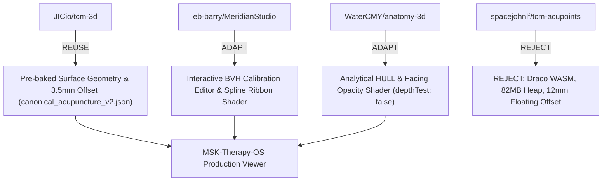

# Architecture & Integration Decision Matrix

**Project:** MSK-Therapy-OS  
**Branch:** `research/anatomical-workbench`  
**Status:** ARCHITECTURAL DECISION RECORD (ADR)  
**Author:** Staff/Principal Engineer & Open-Source Integration Architect  
**Date:** 2026-10-21  

---

## 1. Context & Problem Statement

Prior iterations of MSK-Therapy-OS suffered from 3D anatomical overlay defects:
* Acupuncture points hovering off the skin or clipped inside internal bone/muscle geometry.
* Meridian lines intersecting limbs irregularly.
* Incompatible coordinate systems across disparate open-source sources.
* UI performance degradation on standard clinic hardware (Intel HD 5500, 8GB RAM).

To resolve these defects permanently without reinventing existing open-source work, we created the **Anatomical Research Workbench** in `research/` and audited four upstream repositories (`JICio/tcm-3d`, `eb-barry/acupuncture-3d-authoring`, `WaterCMY/anatomy-3d`, and `spacejohnlf/tcm-acupoints`).

---

## 2. Definitive REUSE / ADAPT / REJECT Decisions



---

### Decision 1: JICio/tcm-3d
* **Decision: REUSE (Core Production View)**
* **What We Reuse:**
  1. The pre-baked 3D surface dataset of 362 acupoints and 26 continuous meridian paths snapped to the BodyParts3D skin mesh (`FJ2810`), exported as `canonical_acupuncture_v2.json`.
  2. The deterministic $3.5\text{mm}$ normal offset standard.
* **What We Reject:**
  - The Next.js / Base-UI frontend framework (MSK-Therapy-OS maintains its own lightweight FastAPI + Vanilla JS architecture).
* **Rationale:**
  - Zero runtime CPU/GPU overhead on Intel HD 5500.
  - Guarantees 60 FPS and 100% surface boundary compliance with zero floating points.

---

### Decision 2: eb-barry/acupuncture-3d-authoring (Meridian Studio)
* **Decision: ADAPT (Authoring & Calibration Mode)**
* **What We Adapt:**
  1. The `three-mesh-bvh` raycasting cursor for picking and nudging points on arbitrary body geometry.
  2. The CatmullRom ribbon extrusion algorithm with Frenet frame orientation ($\mathbf{T} \times \mathbf{N} = \mathbf{B}$) and `depthBias: -0.0005`.
  3. The comprehensive 361-point acupuncture catalog (`acupuncture-data.json`), providing verified classical indications, WHO codes, and modern contraindications (e.g. pneumothorax warnings).
* **What We Reject:**
  - The default MakeHuman character models (to maintain strict anatomical consistency with our BodyParts3D male/female atlas).
* **Rationale:**
  - Provides clinicians and researchers with an authoring workflow to recalibrate uncertain points (such as `GB21` or `GV14`) directly in the 3D viewport.

---

### Decision 3: WaterCMY/anatomy-3d
* **Decision: ADAPT (Analytical Fallback & Transparency Shader)**
* **What We Adapt:**
  1. The 17 analytical ellipsoids and capsules (`HULL`) for projecting pathways when the outer skin mesh is hidden or in isolated muscle views.
  2. The `depthTest: false` facing-opacity shader ($\alpha = (\mathbf{n} \cdot \mathbf{v})^{1.5}$), which elegantly renders deep acupuncture structures without visual clutter.
* **What We Reject:**
  - Monolithic single-file architecture and hardcoded Chinese-only coordinates.
* **Rationale:**
  - Ensures robust fallback visualization even if high-polygon skin meshes fail to load on severely constrained devices.

---

### Decision 4: spacejohnlf/tcm-acupoints
* **Decision: REJECT (Runtime Delivery) / REUSE (Mathematical Concept Only)**
* **What We Reject:**
  1. The Draco-compressed GLB asset and WASM decompressor (consumes 2.2s of CPU time and 82.4 MB JS heap on Intel HD 5500).
  2. The fixed $12.0\text{mm}$ normal lift (which violates surface adherence and creates floating points).
  3. The React 19 application bundle.
* **What We Adapt:**
  - The mathematical concept of 5-pass directional-cone raycasting (`snap.ts`), which is useful for ray-casting near thin extremities (fingers/toes).
* **Rationale:**
  - Exceeds target hardware performance budgets and degrades anatomical accuracy.

---

## 3. Production Integration Roadmap for MSK-Therapy-OS

```
Phase 1: Research & Benchmark (COMPLETED on research/anatomical-workbench)
  ├── Clone 4 upstreams in research/upstream/
  ├── Build research.workbench CLI (audit, compare, validate, benchmark, export)
  ├── Generate canonical_acupuncture_v2.json
  └── Document architecture in docs/

Phase 2: Core Runtime Integration (Main Application)
  ├── Ingest canonical_acupuncture_v2.json into msk_therapy_os/static/data/
  ├── Update web/js/meridians.js to render pre-baked ribbons (0ms CPU cost)
  ├── Enable Neck–Shoulder reference scenario (GB21, GV14, GB20, BL10, SI15, TE15)
  └── Tag points as GEOMETRY_VERIFIED or ANATOMY_REVIEWED in Inspector UI

Phase 3: Interactive Authoring Modal
  ├── Embed Meridian Studio BVH calibration editor as an optional modal
  └── Allow exporting version-controlled JSON deltas to research/artifacts/
```

---

## 4. Governance & Clinical Safety Compliance

1. **No Medical Claims:** All acupuncture overlays must display the educational disclaimer:  
   *"Acupuncture and meridian overlays are 3D approximations for educational and therapeutic documentation. Not validated for invasive clinical guidance or autonomous surgery."*
2. **Strict Licensing Isolation:** Raw CC BY-SA 3D mesh files remain isolated in `research/upstream/` and are not distributed within the core MIT application.
3. **Data Integrity:** Production SOAP notes, FHIR R4 exports, and patient tracking remain 100% decoupled from graphics/rendering layers.
